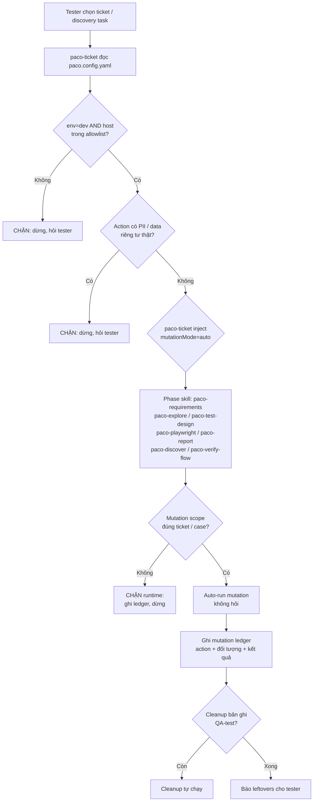

# Paco Auto-Mutation Without Prompt Design

**Ngày:** 2026-10-16
**Trạng thái:** Draft — chờ builder-check và duyệt của tester
**Supersedes:** Mục "Skill behavior", "Runtime behavior", "Khi phải dừng hỏi" của `2026-09-21-paco-dev-autonomous-mutation-policy-design.md` (giữ mục "Ranh giới authorization" và "Ngoài phạm vi" làm baseline).

## 1. Vấn đề

Tester phải nhắc lại "được mutation rồi" nhiều lần trong cùng một ticket, dù spec `2026-09-21-paco-dev-autonomous-mutation-policy-design.md` đã nói rõ bỏ approval gate trên Dev allowlist. Quan sát thực tế:

- Skill con (`paco-playwright`, `paco-explore`, `paco-discover` qua `paco-verify-flow`) vẫn phát câu hỏi mutation trước `click Save` / `Send` / `Delete` / `Upload`.
- `paco-ticket` orchestrator không inject `mutation_approved` flag xuống phase skill con.
- Pattern `paco-mutation-approval-pattern.md` (ghi `## Mutation Policy: APPROVED` vào `status.md`) tồn tại nhưng không có skill nào tự đọc trước khi hỏi.
- Kết quả: hỏi đúp (vừa pattern approval, vừa lời hỏi runtime), mạch làm việc bị đứt, tester phải tự chạy tay.

## 2. Mục tiêu

Trên Paco Dev đã allowlist, agent **tự chạy mutation** cho mọi action phục vụ ticket / discovery đang xử lý, không phát câu hỏi mutation dưới bất kỳ hình thức nào (kể cả "được không?", "OK chứ?", "tôi sẽ..."). Tester vẫn kiểm soát scope qua:

1. Chọn ticket / discovery task.
2. Đăng nhập thủ công.
3. Phê duyệt test recipient ngoài agent (nếu cần gửi email/SMS).
4. Cleanup bản ghi `QA-test` khi xong.

## 3. Ranh giới authorization (giữ nguyên từ spec 09-21)

Một thao tác **tự chạy** khi đồng thời thỏa:

- `environment` là `dev` (đọc từ `paco.config.yaml`).
- Host thuộc `safety.allowedHosts` hoặc `safety.externalDevHosts`. Hỗ trợ wildcard `*` cho hostname (vd `*.blinxpaco-np.com` match `pac2-8575.dev.blinxpaco-np.com` và `blinx.dev.blinxpaco-np.com`). Production dùng domain không chứa `-np` nên wildcard `-np` không lọt vào production.
- Thao tác phục vụ trực tiếp ticket / test case / product survey hiện tại.
- Không chứa dữ liệu riêng tư thật (credentials, auth token, cookie, PII, customer data, production data).

Dừng và hỏi tester chỉ khi:

1. Cần nhập / đọc / gửi dữ liệu riêng tư thật.
2. Host là production, unknown hoặc ngoài allowlist.
3. Authentication cần người dùng tự hoàn tất login / SSO / MFA.
4. SMS gửi ra ngoài (chưa có recipient được duyệt).
5. Missing expected result: không suy đoán `Pass`/`Fail`.

## 4. Phạm vi áp dụng

| Skill | Hành vi mới |
|---|---|
| `paco-ticket` | Orchestrator. Inject `mutationMode: auto` xuống mọi phase skill con khi env=dev và host allowlist. Không hỏi approval. Vẫn gate chặn ở 5 điều kiện mục 3. |
| `paco-requirements` | Không tạo artifact có side effect; không liên quan mutation. **Không thay đổi.** |
| `paco-explore` | `locate` giữ read-only. `observe` và `survey` auto-mutation khi cần kiểm thử trên dev allowlist, scope được orchestrator truyền xuống. |
| `paco-test-design` | Ghi `mutationClass`, `sideEffects`, `cleanup` như metadata. Không tạo approval requirement. |
| `paco-playwright` | Auto-execute selected case trên dev. Không đánh dấu `Blocked` vì thiếu approval. Không hỏi trước mỗi `Save` / `Send` / `Delete` / `Upload`. |
| `paco-report` | Không mutation. Tổng hợp ledger. **Không thay đổi.** |
| `paco-discover` | Auto-mutation trong scope đã reserve. Reservation là approval duy nhất, từ bên ngoài agent. |
| `paco-verify-flow` (con của `paco-discover`) | Auto-mutation theo reservation. Không hỏi lại. |

## 5. Sơ đồ luồng



## 6. Cơ chế inject `mutationMode`

### 6.1. Cách inject (manifest-only)

`paco-ticket` đọc `paco.config.yaml` một lần khi nhận ticket. Nếu thỏa 2 điều kiện (env=dev + host allowlist), nó ghi key `mutationMode: auto` vào `manifest.yaml` của ticket:

```yaml
# docs/tickets/<ticket>/manifest.yaml
mutationMode: auto          # auto | manual
mutationModeSetBy: paco-ticket
mutationModeSetAt: 2026-10-16T10:30:00+07:00
```

`paco-discover` làm tương tự vào `docs/discovery/<task>/manifest.yaml` khi nhận task.

### 6.2. Cách skill con tiêu thụ

Mỗi phase skill (`paco-requirements`, `paco-explore`, `paco-test-design`, `paco-playwright`, `paco-report`, `paco-discover`, `paco-verify-flow`) thêm 1 đoạn ở đầu file `SKILL.md`, **bắt buộc đọc manifest trước action đầu tiên**:

```text
## Mutation Mode

Đọc `manifest.yaml` của ticket / task hiện tại. Nếu `mutationMode=auto`:
- Bỏ qua mọi câu hỏi dạng "được mutation không?", "OK chứ?", "tôi sẽ...".
- Vẫn gate chặn ở 5 điều kiện mục 3.
- Vẫn ghi mutation ledger.

Nếu `mutationMode=manual` hoặc không có: giữ hành vi cũ (hỏi khi cần). Gọi trực tiếp ngoài orchestrator cũng rơi vào nhánh này.
```

Đọc file là runtime guard, không phải parse prompt args.

### 6.3. Tương thích ngược

- `paco-mutation-approval-pattern.md` (ghi `## Mutation Policy: APPROVED` vào `status.md`) vẫn hợp lệ. Skill con check theo thứ tự: `manifest.yaml:mutationMode` trước, `status.md:Mutation Policy` sau. Nếu 1 trong 2 = approved/auto → auto-run.
- Hai nguồn cùng nói `auto` thì chỉ ghi 1 dòng ledger "source=manifest" hoặc "source=status", tránh log đúp.

### 6.3. Tương thích ngược

- `paco-mutation-approval-pattern.md` (ghi `## Mutation Policy: APPROVED` vào `status.md`) vẫn hợp lệ, trở thành fallback thứ hai: nếu orchestrator không inject nhưng status.md có `Mutation Policy: APPROVED`, skill con tự suy ra `mutationMode=auto`.
- Pattern này chỉ còn hữu ích khi gọi skill con trực tiếp, không qua `paco-ticket`.

## 7. Runtime guard (giữ từ spec 09-21, có thêm 1 hook)

Mỗi mutation trước khi chạy phải pass 4 check (không phải prompt, là runtime guard viết trong skill):

1. `environment` ∈ `mutationEnabledEnvironments` của `paco.config.yaml`.
2. Host hiện tại match pattern trong `allowedHosts ∪ externalDevHosts` (exact hostname hoặc wildcard `*`).
3. Action scope (run / action / class / test-data / recipient) nằm trong ticket hoặc discovery task đang xử lý.
4. Không match sensitive-data pattern (regex / heuristic detect email thật, SSN, phone, auth header).

Nếu fail bất kỳ check nào: dừng, ghi ledger `[BLOCKED] reason=...`, in lý do cho tester, không retry.

## 8. Mutation ledger (giữ từ spec 09-21, mở rộng field)

Ghi vào `docs/tickets/<ticket>/mutation-ledger.md` (ticket workflow) hoặc `docs/discovery/<task>/mutation-ledger.md` (product discovery):

| Field | Bắt buộc | Mô tả |
|---|---|---|
| timestamp | ✓ | ISO 8601, local time |
| ticket / task | ✓ | ID |
| env + host | ✓ | dev / host:port |
| skill | ✓ | `paco-playwright` / `paco-explore` / `paco-discover` |
| action class | ✓ | `Create` / `Update` / `Delete` / `Send` / `Upload` / `Import` / `Download` / `Approve` / `Reject` / `Restore` |
| target | ✓ | URL, selector, ID, record name |
| scope ref | ✓ | run id, case id, hoặc discovery sub-task id |
| test data | ✓ | Tên bản ghi (vd `QA-test-patient-2026-10-16-001`) |
| source | ✓ | `manifest` hoặc `status` (ghi nguồn policy quyết định auto-run, tránh log đúp nếu cả 2 cùng bật) |
| result | ✓ | `executed` / `blocked` / `failed` / `cleanup-done` |
| leftover | nếu còn | Bản ghi `QA-test` chưa cleanup |

## 9. Cleanup

- Tự chạy khi không xoá dữ liệu nền hoặc làm mất evidence cần báo cáo.
- Skill phụ trách phase cuối cùng chạm record (`paco-playwright` cho ticket, `paco-verify-flow` cho discovery) chịu trách nhiệm cleanup trong scope của nó.
- Cuối phase: in số leftover, danh sách record `QA-test` còn tồn tại.

## 10. Tiêu chí chấp nhận

### 10.1. Static scan (build vào CI hook mới hoặc `npm run check:mutation-policy`)

- Không còn câu nào trong 6 skill files (trừ `paco-requirements`, `paco-report`) match pattern `/(xin|được|ok).{0,30}(mutation|sửa|xóa|gửi|save|delete|send|upload|approve)/i` khi `mutationMode=auto`.
- Không còn reference tới `PACO_ALLOW_MUTATION` / `PACO_ALLOW_DESTRUCTIVE` (đã bỏ ở spec 09-21 nhưng chưa verify).
- Mỗi skill có section `## Mutation Mode` nếu liên quan.

### 10.2. Scenario check (chạy tay trên 1 ticket thật)

| Scenario | Kỳ vọng |
|---|---|
| Allowlisted Dev + `Save` button | Auto-click, ghi ledger, không hỏi |
| Allowlisted Dev + `Send email` tới `fiona.nguyen@blinxsolutions.com` | Auto-send, ghi ledger |
| Allowlisted Dev + `Delete` record `QA-test-X` | Auto-delete, ghi ledger, cleanup |
| Allowlisted Dev + `Send SMS` | **Dừng hỏi** (chưa có recipient) |
| Production host | **Chặn** trước khi load page |
| Real PII trong form | **Dừng hỏi** |
| Missing expected result | **Dừng hỏi** kết quả, không đoán |

## 11. Ngoài phạm vi

- Không nới quyền cho production.
- Không lưu credentials / auth state vào docs hoặc source.
- Không bỏ mutation ledger, cleanup tracking, evidence redaction, protected `## Tester notes`.
- Không tự bật guard hay tự cấp authorization.
- Không thay đổi `paco-requirements` và `paco-report` (không mutation).

## 12. Open question

1. `paco-discover` có cần `manifest.yaml` riêng cho mỗi task, hay đọc từ `docs/discovery/<task>/status.md`? (Hiện chưa rõ convention.)
2. Static scan chạy ở `pre-commit` hay `npm run check`? (Tester tự quyết khi implement.)
3. Khi skill con phát hiện sensitive data, có nên auto-redact trước khi hỏi, hay bắt buộc hỏi thô? (Nghiêng về hỏi vì an toàn hơn.)

**Assumption cần xác nhận khi implement:** Production host không chứa `-np` trong hostname, nên wildcard `*.blinxpaco-np.com` không lọt vào production. Nếu sai, đổi thành `*.dev.blinxpaco-np.com`.

## 13. Lịch sử

- 2026-09-21: Spec gốc `2026-09-21-paco-dev-autonomous-mutation-policy-design.md` — đặt ranh giới authorization nhưng chưa liệt kê skill cụ thể.
- 2026-10-16: Spec này — mở rộng cho 7 skill, có sơ đồ, có cơ chế inject, có static scan, có scenario check.
