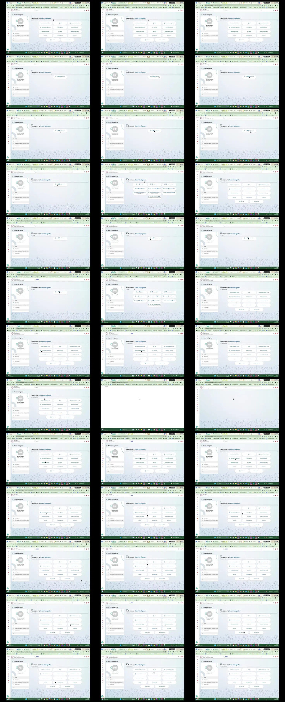

# Video timeline

**Source:** `126785-no tiles clickable in connect.mp4`  
**Duration:** 38.609300 seconds  
**Video:** h264, 1920x1080

## Contact sheet

## Timeline

| Frame | Timestamp | Review status | Environment | Role | Visual observation | Evidence |
|---|---:|---|---|---|---|---|
| `frames/frame-0001.webp` | `00:00:00.000` | Unreviewed |  |  |  |  |
| `frames/frame-0002.webp` | `00:00:01.002` | Unreviewed |  |  |  |  |
| `frames/frame-0003.webp` | `00:00:02.008` | Unreviewed |  |  |  |  |
| `frames/frame-0004.webp` | `00:00:03.010` | Unreviewed |  |  |  |  |
| `frames/frame-0005.webp` | `00:00:04.014` | Unreviewed |  |  |  |  |
| `frames/frame-0006.webp` | `00:00:05.021` | Unreviewed |  |  |  |  |
| `frames/frame-0007.webp` | `00:00:06.030` | Unreviewed |  |  |  |  |
| `frames/frame-0008.webp` | `00:00:07.032` | Unreviewed |  |  |  |  |
| `frames/frame-0009.webp` | `00:00:08.036` | Unreviewed |  |  |  |  |
| `frames/frame-0010.webp` | `00:00:09.038` | Unreviewed |  |  |  |  |
| `frames/frame-0011.webp` | `00:00:10.042` | Unreviewed |  |  |  |  |
| `frames/frame-0012.webp` | `00:00:11.051` | Unreviewed |  |  |  |  |
| `frames/frame-0013.webp` | `00:00:12.080` | Unreviewed |  |  |  |  |
| `frames/frame-0014.webp` | `00:00:13.086` | Unreviewed |  |  |  |  |
| `frames/frame-0015.webp` | `00:00:14.092` | Unreviewed |  |  |  |  |
| `frames/frame-0016.webp` | `00:00:15.125` | Unreviewed |  |  |  |  |
| `frames/frame-0017.webp` | `00:00:16.158` | Unreviewed |  |  |  |  |
| `frames/frame-0018.webp` | `00:00:17.164` | Unreviewed |  |  |  |  |
| `frames/frame-0019.webp` | `00:00:18.165` | Unreviewed |  |  |  |  |
| `frames/frame-0020.webp` | `00:00:19.175` | Unreviewed |  |  |  |  |
| `frames/frame-0021.webp` | `00:00:20.177` | Unreviewed |  |  |  |  |
| `frames/frame-0022.webp` | `00:00:21.185` | Unreviewed |  |  |  |  |
| `frames/frame-0023.webp` | `00:00:22.195` | Unreviewed |  |  |  |  |
| `frames/frame-0024.webp` | `00:00:23.200` | Unreviewed |  |  |  |  |
| `frames/frame-0025.webp` | `00:00:24.207` | Unreviewed |  |  |  |  |
| `frames/frame-0026.webp` | `00:00:25.209` | Unreviewed |  |  |  |  |
| `frames/frame-0027.webp` | `00:00:26.212` | Unreviewed |  |  |  |  |
| `frames/frame-0028.webp` | `00:00:27.220` | Unreviewed |  |  |  |  |
| `frames/frame-0029.webp` | `00:00:28.221` | Unreviewed |  |  |  |  |
| `frames/frame-0030.webp` | `00:00:29.241` | Unreviewed |  |  |  |  |
| `frames/frame-0031.webp` | `00:00:30.248` | Unreviewed |  |  |  |  |
| `frames/frame-0032.webp` | `00:00:31.255` | Unreviewed |  |  |  |  |
| `frames/frame-0033.webp` | `00:00:32.257` | Unreviewed |  |  |  |  |
| `frames/frame-0034.webp` | `00:00:33.289` | Unreviewed |  |  |  |  |
| `frames/frame-0035.webp` | `00:00:34.298` | Unreviewed |  |  |  |  |
| `frames/frame-0036.webp` | `00:00:35.310` | Unreviewed |  |  |  |  |
| `frames/frame-0037.webp` | `00:00:36.316` | Unreviewed |  |  |  |  |
| `frames/frame-0038.webp` | `00:00:37.323` | Unreviewed |  |  |  |  |
| `frames/frame-0039.webp` | `00:00:38.357` | Unreviewed |  |  |  |  |

Frame timestamps are technical extraction aids. Record `Observed` only after visual review adds environment, role, observation and evidence reference.

## Open questions

- Review each frame before using it as requirement evidence.

## Tester notes

[Protected area]
