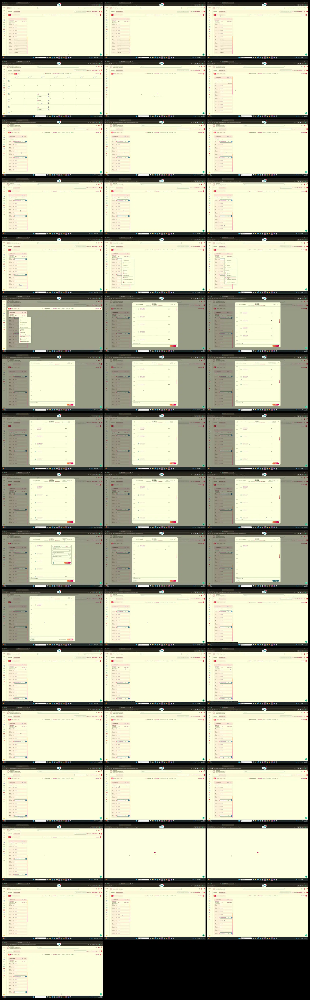

# Video timeline

**Source:** `128884-Remove slots time update fail.mp4`  
**Duration:** 47.629533 seconds  
**Video:** h264, 1920x1080

## Contact sheet

## Timeline

| Frame | Timestamp | Review status | Environment | Role | Visual observation | Evidence |
|---|---:|---|---|---|---|---|
| `frames/frame-0001.webp` | `00:00:00.000` | Unreviewed |  |  |  |  |
| `frames/frame-0002.webp` | `00:00:01.000` | Unreviewed |  |  |  |  |
| `frames/frame-0003.webp` | `00:00:02.027` | Unreviewed |  |  |  |  |
| `frames/frame-0004.webp` | `00:00:03.036` | Unreviewed |  |  |  |  |
| `frames/frame-0005.webp` | `00:00:04.069` | Unreviewed |  |  |  |  |
| `frames/frame-0006.webp` | `00:00:05.069` | Unreviewed |  |  |  |  |
| `frames/frame-0007.webp` | `00:00:06.072` | Unreviewed |  |  |  |  |
| `frames/frame-0008.webp` | `00:00:07.107` | Unreviewed |  |  |  |  |
| `frames/frame-0009.webp` | `00:00:08.134` | Unreviewed |  |  |  |  |
| `frames/frame-0010.webp` | `00:00:09.141` | Unreviewed |  |  |  |  |
| `frames/frame-0011.webp` | `00:00:10.166` | Unreviewed |  |  |  |  |
| `frames/frame-0012.webp` | `00:00:11.171` | Unreviewed |  |  |  |  |
| `frames/frame-0013.webp` | `00:00:12.199` | Unreviewed |  |  |  |  |
| `frames/frame-0014.webp` | `00:00:13.203` | Unreviewed |  |  |  |  |
| `frames/frame-0015.webp` | `00:00:14.211` | Unreviewed |  |  |  |  |
| `frames/frame-0016.webp` | `00:00:14.514` | Unreviewed |  |  |  |  |
| `frames/frame-0017.webp` | `00:00:15.546` | Unreviewed |  |  |  |  |
| `frames/frame-0018.webp` | `00:00:16.554` | Unreviewed |  |  |  |  |
| `frames/frame-0019.webp` | `00:00:17.558` | Unreviewed |  |  |  |  |
| `frames/frame-0020.webp` | `00:00:18.561` | Unreviewed |  |  |  |  |
| `frames/frame-0021.webp` | `00:00:19.593` | Unreviewed |  |  |  |  |
| `frames/frame-0022.webp` | `00:00:20.627` | Unreviewed |  |  |  |  |
| `frames/frame-0023.webp` | `00:00:21.678` | Unreviewed |  |  |  |  |
| `frames/frame-0024.webp` | `00:00:22.713` | Unreviewed |  |  |  |  |
| `frames/frame-0025.webp` | `00:00:23.723` | Unreviewed |  |  |  |  |
| `frames/frame-0026.webp` | `00:00:24.725` | Unreviewed |  |  |  |  |
| `frames/frame-0027.webp` | `00:00:25.750` | Unreviewed |  |  |  |  |
| `frames/frame-0028.webp` | `00:00:26.756` | Unreviewed |  |  |  |  |
| `frames/frame-0029.webp` | `00:00:27.765` | Unreviewed |  |  |  |  |
| `frames/frame-0030.webp` | `00:00:28.797` | Unreviewed |  |  |  |  |
| `frames/frame-0031.webp` | `00:00:29.822` | Unreviewed |  |  |  |  |
| `frames/frame-0032.webp` | `00:00:30.069` | Unreviewed |  |  |  |  |
| `frames/frame-0033.webp` | `00:00:31.096` | Unreviewed |  |  |  |  |
| `frames/frame-0034.webp` | `00:00:32.126` | Unreviewed |  |  |  |  |
| `frames/frame-0035.webp` | `00:00:33.157` | Unreviewed |  |  |  |  |
| `frames/frame-0036.webp` | `00:00:34.161` | Unreviewed |  |  |  |  |
| `frames/frame-0037.webp` | `00:00:35.166` | Unreviewed |  |  |  |  |
| `frames/frame-0038.webp` | `00:00:36.170` | Unreviewed |  |  |  |  |
| `frames/frame-0039.webp` | `00:00:37.173` | Unreviewed |  |  |  |  |
| `frames/frame-0040.webp` | `00:00:38.176` | Unreviewed |  |  |  |  |
| `frames/frame-0041.webp` | `00:00:39.179` | Unreviewed |  |  |  |  |
| `frames/frame-0042.webp` | `00:00:40.179` | Unreviewed |  |  |  |  |
| `frames/frame-0043.webp` | `00:00:41.188` | Unreviewed |  |  |  |  |
| `frames/frame-0044.webp` | `00:00:42.216` | Unreviewed |  |  |  |  |
| `frames/frame-0045.webp` | `00:00:43.221` | Unreviewed |  |  |  |  |
| `frames/frame-0046.webp` | `00:00:44.245` | Unreviewed |  |  |  |  |
| `frames/frame-0047.webp` | `00:00:45.262` | Unreviewed |  |  |  |  |
| `frames/frame-0048.webp` | `00:00:46.263` | Unreviewed |  |  |  |  |
| `frames/frame-0049.webp` | `00:00:47.264` | Unreviewed |  |  |  |  |

Frame timestamps are technical extraction aids. Record `Observed` only after visual review adds environment, role, observation and evidence reference.

## Open questions

- Review each frame before using it as requirement evidence.

## Tester notes

[Protected area]
