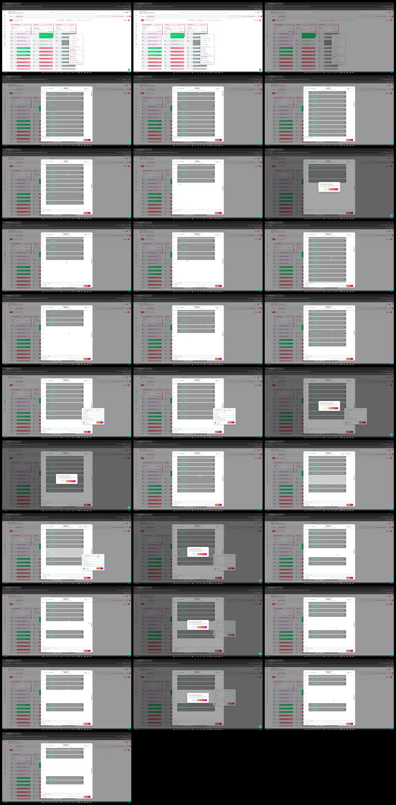

# Video timeline

**Source:** `128920-8858 Third QA.mp4`  
**Duration:** 27.221313 seconds  
**Video:** h264, 1920x1052

## Contact sheet

## Timeline

| Frame | Timestamp | Review status | Environment | Role | Visual observation | Evidence |
|---|---:|---|---|---|---|---|
| `frames/frame-0001.webp` | `00:00:00.000` | Unreviewed |  |  |  |  |
| `frames/frame-0002.webp` | `00:00:01.000` | Unreviewed |  |  |  |  |
| `frames/frame-0003.webp` | `00:00:01.300` | Unreviewed |  |  |  |  |
| `frames/frame-0004.webp` | `00:00:02.300` | Unreviewed |  |  |  |  |
| `frames/frame-0005.webp` | `00:00:03.300` | Unreviewed |  |  |  |  |
| `frames/frame-0006.webp` | `00:00:04.333` | Unreviewed |  |  |  |  |
| `frames/frame-0007.webp` | `00:00:05.333` | Unreviewed |  |  |  |  |
| `frames/frame-0008.webp` | `00:00:06.333` | Unreviewed |  |  |  |  |
| `frames/frame-0009.webp` | `00:00:06.533` | Unreviewed |  |  |  |  |
| `frames/frame-0010.webp` | `00:00:07.433` | Unreviewed |  |  |  |  |
| `frames/frame-0011.webp` | `00:00:08.433` | Unreviewed |  |  |  |  |
| `frames/frame-0012.webp` | `00:00:09.433` | Unreviewed |  |  |  |  |
| `frames/frame-0013.webp` | `00:00:10.433` | Unreviewed |  |  |  |  |
| `frames/frame-0014.webp` | `00:00:11.433` | Unreviewed |  |  |  |  |
| `frames/frame-0015.webp` | `00:00:12.433` | Unreviewed |  |  |  |  |
| `frames/frame-0016.webp` | `00:00:13.433` | Unreviewed |  |  |  |  |
| `frames/frame-0017.webp` | `00:00:14.433` | Unreviewed |  |  |  |  |
| `frames/frame-0018.webp` | `00:00:15.067` | Unreviewed |  |  |  |  |
| `frames/frame-0019.webp` | `00:00:16.100` | Unreviewed |  |  |  |  |
| `frames/frame-0020.webp` | `00:00:16.633` | Unreviewed |  |  |  |  |
| `frames/frame-0021.webp` | `00:00:17.633` | Unreviewed |  |  |  |  |
| `frames/frame-0022.webp` | `00:00:18.633` | Unreviewed |  |  |  |  |
| `frames/frame-0023.webp` | `00:00:18.700` | Unreviewed |  |  |  |  |
| `frames/frame-0024.webp` | `00:00:19.633` | Unreviewed |  |  |  |  |
| `frames/frame-0025.webp` | `00:00:20.633` | Unreviewed |  |  |  |  |
| `frames/frame-0026.webp` | `00:00:21.300` | Unreviewed |  |  |  |  |
| `frames/frame-0027.webp` | `00:00:22.133` | Unreviewed |  |  |  |  |
| `frames/frame-0028.webp` | `00:00:23.133` | Unreviewed |  |  |  |  |
| `frames/frame-0029.webp` | `00:00:24.100` | Unreviewed |  |  |  |  |
| `frames/frame-0030.webp` | `00:00:25.100` | Unreviewed |  |  |  |  |
| `frames/frame-0031.webp` | `00:00:26.100` | Unreviewed |  |  |  |  |

Frame timestamps are technical extraction aids. Record `Observed` only after visual review adds environment, role, observation and evidence reference.

## Open questions

- Review each frame before using it as requirement evidence.

## Tester notes

[Protected area]
