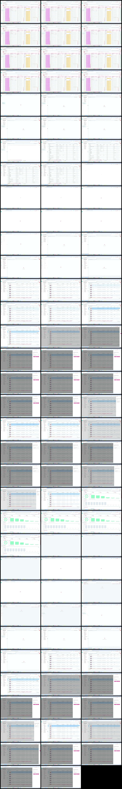

# Video timeline

**Source:** `128932-8931.mp4`  
**Duration:** 94.981479 seconds  
**Video:** h264, 1920x1080

## Contact sheet

## Timeline

| Frame | Timestamp | Review status | Environment | Role | Visual observation | Evidence |
|---|---:|---|---|---|---|---|
| `frames/frame-0001.webp` | `00:00:00.000` | Unreviewed |  |  |  |  |
| `frames/frame-0002.webp` | `00:00:01.003` | Unreviewed |  |  |  |  |
| `frames/frame-0003.webp` | `00:00:02.003` | Unreviewed |  |  |  |  |
| `frames/frame-0004.webp` | `00:00:03.030` | Unreviewed |  |  |  |  |
| `frames/frame-0005.webp` | `00:00:04.041` | Unreviewed |  |  |  |  |
| `frames/frame-0006.webp` | `00:00:05.051` | Unreviewed |  |  |  |  |
| `frames/frame-0007.webp` | `00:00:06.085` | Unreviewed |  |  |  |  |
| `frames/frame-0008.webp` | `00:00:07.102` | Unreviewed |  |  |  |  |
| `frames/frame-0009.webp` | `00:00:08.113` | Unreviewed |  |  |  |  |
| `frames/frame-0010.webp` | `00:00:09.119` | Unreviewed |  |  |  |  |
| `frames/frame-0011.webp` | `00:00:10.125` | Unreviewed |  |  |  |  |
| `frames/frame-0012.webp` | `00:00:11.144` | Unreviewed |  |  |  |  |
| `frames/frame-0013.webp` | `00:00:12.146` | Unreviewed |  |  |  |  |
| `frames/frame-0014.webp` | `00:00:13.149` | Unreviewed |  |  |  |  |
| `frames/frame-0015.webp` | `00:00:14.185` | Unreviewed |  |  |  |  |
| `frames/frame-0016.webp` | `00:00:15.199` | Unreviewed |  |  |  |  |
| `frames/frame-0017.webp` | `00:00:16.200` | Unreviewed |  |  |  |  |
| `frames/frame-0018.webp` | `00:00:17.203` | Unreviewed |  |  |  |  |
| `frames/frame-0019.webp` | `00:00:18.234` | Unreviewed |  |  |  |  |
| `frames/frame-0020.webp` | `00:00:19.272` | Unreviewed |  |  |  |  |
| `frames/frame-0021.webp` | `00:00:20.297` | Unreviewed |  |  |  |  |
| `frames/frame-0022.webp` | `00:00:21.302` | Unreviewed |  |  |  |  |
| `frames/frame-0023.webp` | `00:00:22.310` | Unreviewed |  |  |  |  |
| `frames/frame-0024.webp` | `00:00:23.354` | Unreviewed |  |  |  |  |
| `frames/frame-0025.webp` | `00:00:24.361` | Unreviewed |  |  |  |  |
| `frames/frame-0026.webp` | `00:00:25.363` | Unreviewed |  |  |  |  |
| `frames/frame-0027.webp` | `00:00:26.366` | Unreviewed |  |  |  |  |
| `frames/frame-0028.webp` | `00:00:27.395` | Unreviewed |  |  |  |  |
| `frames/frame-0029.webp` | `00:00:28.400` | Unreviewed |  |  |  |  |
| `frames/frame-0030.webp` | `00:00:29.401` | Unreviewed |  |  |  |  |
| `frames/frame-0031.webp` | `00:00:30.452` | Unreviewed |  |  |  |  |
| `frames/frame-0032.webp` | `00:00:31.458` | Unreviewed |  |  |  |  |
| `frames/frame-0033.webp` | `00:00:32.465` | Unreviewed |  |  |  |  |
| `frames/frame-0034.webp` | `00:00:33.501` | Unreviewed |  |  |  |  |
| `frames/frame-0035.webp` | `00:00:34.537` | Unreviewed |  |  |  |  |
| `frames/frame-0036.webp` | `00:00:35.545` | Unreviewed |  |  |  |  |
| `frames/frame-0037.webp` | `00:00:36.569` | Unreviewed |  |  |  |  |
| `frames/frame-0038.webp` | `00:00:37.599` | Unreviewed |  |  |  |  |
| `frames/frame-0039.webp` | `00:00:38.608` | Unreviewed |  |  |  |  |
| `frames/frame-0040.webp` | `00:00:39.624` | Unreviewed |  |  |  |  |
| `frames/frame-0041.webp` | `00:00:40.628` | Unreviewed |  |  |  |  |
| `frames/frame-0042.webp` | `00:00:41.637` | Unreviewed |  |  |  |  |
| `frames/frame-0043.webp` | `00:00:42.650` | Unreviewed |  |  |  |  |
| `frames/frame-0044.webp` | `00:00:42.952` | Unreviewed |  |  |  |  |
| `frames/frame-0045.webp` | `00:00:43.018` | Unreviewed |  |  |  |  |
| `frames/frame-0046.webp` | `00:00:44.053` | Unreviewed |  |  |  |  |
| `frames/frame-0047.webp` | `00:00:45.058` | Unreviewed |  |  |  |  |
| `frames/frame-0048.webp` | `00:00:46.087` | Unreviewed |  |  |  |  |
| `frames/frame-0049.webp` | `00:00:47.088` | Unreviewed |  |  |  |  |
| `frames/frame-0050.webp` | `00:00:48.088` | Unreviewed |  |  |  |  |
| `frames/frame-0051.webp` | `00:00:49.095` | Unreviewed |  |  |  |  |
| `frames/frame-0052.webp` | `00:00:50.125` | Unreviewed |  |  |  |  |
| `frames/frame-0053.webp` | `00:00:51.129` | Unreviewed |  |  |  |  |
| `frames/frame-0054.webp` | `00:00:51.590` | Unreviewed |  |  |  |  |
| `frames/frame-0055.webp` | `00:00:52.622` | Unreviewed |  |  |  |  |
| `frames/frame-0056.webp` | `00:00:53.649` | Unreviewed |  |  |  |  |
| `frames/frame-0057.webp` | `00:00:53.773` | Unreviewed |  |  |  |  |
| `frames/frame-0058.webp` | `00:00:54.782` | Unreviewed |  |  |  |  |
| `frames/frame-0059.webp` | `00:00:55.812` | Unreviewed |  |  |  |  |
| `frames/frame-0060.webp` | `00:00:56.824` | Unreviewed |  |  |  |  |
| `frames/frame-0061.webp` | `00:00:57.886` | Unreviewed |  |  |  |  |
| `frames/frame-0062.webp` | `00:00:58.889` | Unreviewed |  |  |  |  |
| `frames/frame-0063.webp` | `00:00:59.071` | Unreviewed |  |  |  |  |
| `frames/frame-0064.webp` | `00:00:59.132` | Unreviewed |  |  |  |  |
| `frames/frame-0065.webp` | `00:01:00.137` | Unreviewed |  |  |  |  |
| `frames/frame-0066.webp` | `00:01:01.182` | Unreviewed |  |  |  |  |
| `frames/frame-0067.webp` | `00:01:02.219` | Unreviewed |  |  |  |  |
| `frames/frame-0068.webp` | `00:01:03.234` | Unreviewed |  |  |  |  |
| `frames/frame-0069.webp` | `00:01:04.260` | Unreviewed |  |  |  |  |
| `frames/frame-0070.webp` | `00:01:05.290` | Unreviewed |  |  |  |  |
| `frames/frame-0071.webp` | `00:01:06.292` | Unreviewed |  |  |  |  |
| `frames/frame-0072.webp` | `00:01:07.294` | Unreviewed |  |  |  |  |
| `frames/frame-0073.webp` | `00:01:08.299` | Unreviewed |  |  |  |  |
| `frames/frame-0074.webp` | `00:01:09.303` | Unreviewed |  |  |  |  |
| `frames/frame-0075.webp` | `00:01:10.309` | Unreviewed |  |  |  |  |
| `frames/frame-0076.webp` | `00:01:11.335` | Unreviewed |  |  |  |  |
| `frames/frame-0077.webp` | `00:01:12.346` | Unreviewed |  |  |  |  |
| `frames/frame-0078.webp` | `00:01:13.350` | Unreviewed |  |  |  |  |
| `frames/frame-0079.webp` | `00:01:14.364` | Unreviewed |  |  |  |  |
| `frames/frame-0080.webp` | `00:01:15.373` | Unreviewed |  |  |  |  |
| `frames/frame-0081.webp` | `00:01:16.401` | Unreviewed |  |  |  |  |
| `frames/frame-0082.webp` | `00:01:17.403` | Unreviewed |  |  |  |  |
| `frames/frame-0083.webp` | `00:01:18.411` | Unreviewed |  |  |  |  |
| `frames/frame-0084.webp` | `00:01:19.448` | Unreviewed |  |  |  |  |
| `frames/frame-0085.webp` | `00:01:20.485` | Unreviewed |  |  |  |  |
| `frames/frame-0086.webp` | `00:01:21.516` | Unreviewed |  |  |  |  |
| `frames/frame-0087.webp` | `00:01:22.546` | Unreviewed |  |  |  |  |
| `frames/frame-0088.webp` | `00:01:23.559` | Unreviewed |  |  |  |  |
| `frames/frame-0089.webp` | `00:01:24.381` | Unreviewed |  |  |  |  |
| `frames/frame-0090.webp` | `00:01:25.406` | Unreviewed |  |  |  |  |
| `frames/frame-0091.webp` | `00:01:26.431` | Unreviewed |  |  |  |  |
| `frames/frame-0092.webp` | `00:01:27.433` | Unreviewed |  |  |  |  |
| `frames/frame-0093.webp` | `00:01:28.435` | Unreviewed |  |  |  |  |
| `frames/frame-0094.webp` | `00:01:28.590` | Unreviewed |  |  |  |  |
| `frames/frame-0095.webp` | `00:01:29.590` | Unreviewed |  |  |  |  |
| `frames/frame-0096.webp` | `00:01:30.231` | Unreviewed |  |  |  |  |
| `frames/frame-0097.webp` | `00:01:30.321` | Unreviewed |  |  |  |  |
| `frames/frame-0098.webp` | `00:01:31.334` | Unreviewed |  |  |  |  |
| `frames/frame-0099.webp` | `00:01:32.336` | Unreviewed |  |  |  |  |
| `frames/frame-0100.webp` | `00:01:33.340` | Unreviewed |  |  |  |  |
| `frames/frame-0101.webp` | `00:01:34.370` | Unreviewed |  |  |  |  |

Frame timestamps are technical extraction aids. Record `Observed` only after visual review adds environment, role, observation and evidence reference.

## Open questions

- Review each frame before using it as requirement evidence.

## Tester notes

[Protected area]
